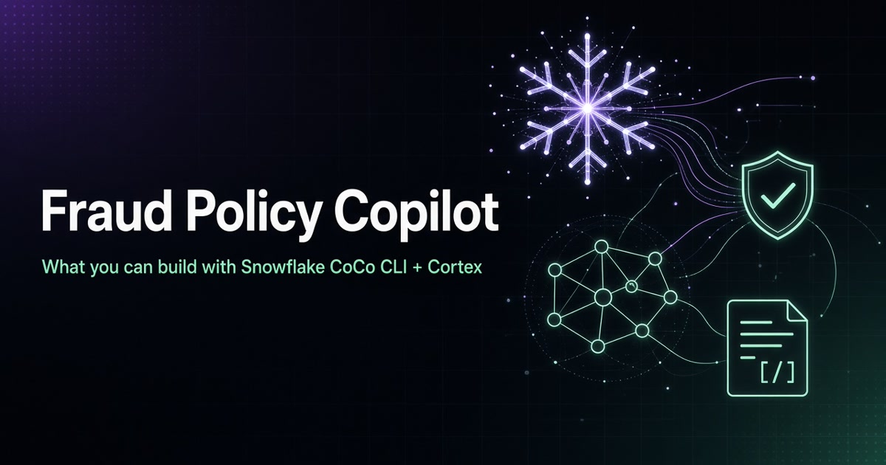
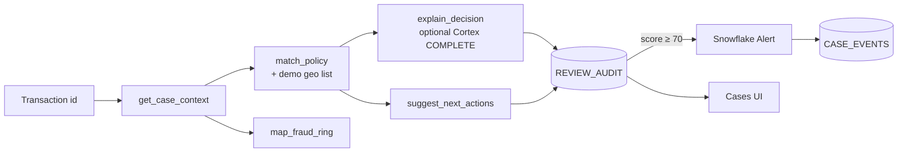

# Fraud Policy Copilot — what you can build with Snowflake CoCo CLI + Cortex



> I designed and built a fraud-analyst copilot that goes from a **flagged transaction** to a **policy-cited decision**, a **fraud-ring map**, a **case**, and a **native Snowflake alert trail**, all inside Snowflake.


[](https://youtu.be/5t6cmuguZ9Q)

▶️ **[Watch the demo](https://youtu.be/5t6cmuguZ9Q)** · 📝 **[Read the full write-up](https://savvysuhail.com/fraud-policy-copilot/)** · 🎞️ [Demo video file in this repo](docs/Fraud_Policy_Copilot_Demo_Snowflake_Coretx.mp4)

---

## The problem

Fraud analysts burn time hunting AML / KYC policy text for every alert. I wanted to show how CoCo CLI skills and Snowflake-native features can turn that into one guided flow: give it a transaction id, and it loads customer context, matches rules, and returns a **risk score**, **citations**, **next actions**, plus optional **ring** and **case** workflow — without data leaving Snowflake.

## What it does

| Tab | What you see |
|-----|----------------|
| **Review** | `T2005` → score + fired rules → Open case |
| **Fraud ring** | `C005` → shared device / IBAN cluster |
| **Cases** | Status transitions + comments |
| **Alerts** | `REVIEW_AUDIT` + Snowflake `FRAUD_HIGH_RISK_ALERT` events |

---

## Design



**Design choices**

- **Modular skills, one workflow.** Each step is a small CoCo CLI skill; the `fraud_case_review` workflow chains them end-to-end on the CLI path.
- **Same logic in two front doors.** The Streamlit-in-Snowflake app mirrors the skills' decision logic for a live, clickable demo.
- **Monitoring is native.** High-risk reviews fire a real Snowflake Alert into an event trail, not just a UI flash.
- **Cortex where it helps.** `explain_decision` can call `SNOWFLAKE.CORTEX.COMPLETE` for the narrative, with a static fallback if Cortex isn't enabled.

**Stack:** Snowflake · Streamlit in Snowflake · CoCo CLI skills · Snowflake Cortex (optional) · SQL tables / views / Alert · Python

---

## Modular skills

| Skill | Role |
|--------|------|
| [`get_case_context`](skills/get_case_context/SKILL.md) | Customer + recent transactions |
| [`match_policy`](skills/match_policy/SKILL.md) | Score against AML-style rules |
| [`explain_decision`](skills/explain_decision/SKILL.md) | Citations + recommendation |
| [`suggest_next_actions`](skills/suggest_next_actions/SKILL.md) | Analyst next steps |
| [`map_fraud_ring`](skills/map_fraud_ring/SKILL.md) | Shared device / IBAN / phone / merchant links |

Workflow: [`fraud_case_review`](workflow/fraud_case_review/WORKFLOW.md) chains the review skills end-to-end.

---

## Quick start

### 1. Load Snowflake objects
In a worksheet (`ACCOUNTADMIN`, warehouse `COMPUTE_WH`):

```sql
USE DATABASE FRAUD_COPILOT;
USE SCHEMA DEMO;
```

Run [`sql/01`](sql/01_sample_data.sql) → [`02`](sql/02_cases_and_audit.sql) → [`03`](sql/03_audit_and_alert.sql) → [`04`](sql/04_fraud_ring_graph.sql) → [`05`](sql/05_case_management.sql) in order.
Details and alert checks: **[docs/GUIDE.md](docs/GUIDE.md)**.

### 2. Open the Streamlit app
- Entry file: **[`app/streamlit_app.py`](app/streamlit_app.py)** (single app file)
- In Snowflake: Streamlit app on `FRAUD_COPILOT.DEMO` (Git sync or paste)
- No `secrets.toml` needed in SiS (`get_active_session()`)

### 3. Walk through it
Follow the 4-minute walkthrough in **[docs/GUIDE.md](docs/GUIDE.md)**.

---

## Repo layout

```text
app/
  streamlit_app.py          # Only Streamlit entry (SiS)
  requirements.txt
  .streamlit/               # Local optional config example
docs/
  GUIDE.md                  # Full setup, phases, walkthrough
  Fraud_Policy_Copilot_Demo_Snowflake_Coretx.mp4
sql/
  01_sample_data.sql
  02_cases_and_audit.sql
  03_audit_and_alert.sql    # REVIEW_AUDIT + Alert
  04_fraud_ring_graph.sql
  05_case_management.sql
skills/                     # CoCo CLI skills
workflow/                   # fraud_case_review
README.md
environment.yml
```

---

## Build phases

1. **Review & cases** — scoring UI, audit, open case
2. **Fraud ring & case management** — graph + status workflow
3. **Alerts** — `REVIEW_AUDIT` + Snowflake Alert → `ALERT_HIGH_RISK`

---

## Limitations

- **Prototype**, built for clarity: small sample data, not a production sanctions product.
- **Demo sanctions list only** (`CY`, `IR`, `KP`, `RU`) — live sanctions APIs intentionally skipped.
- Cortex narrative is optional and depends on Cortex being enabled in your account.

## Lessons learned

- Splitting the flow into small skills made each step easy to test and reuse across the CLI and the app.
- Using a native Snowflake Alert gives a real monitoring trail instead of a one-off UI notification.
- Being honest about the demo sanctions list beats faking a live feed.

---

Built by [Suhail Ahmed](https://savvysuhail.com/) — I design and build AI agents, LLM routers and RAG on cloud and data.

<sub>Originally built for the Snowflake CoCo CLI hackathon.</sub>
